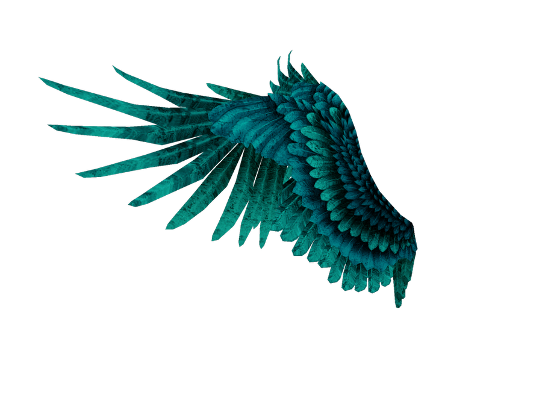
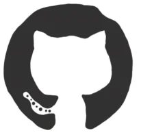
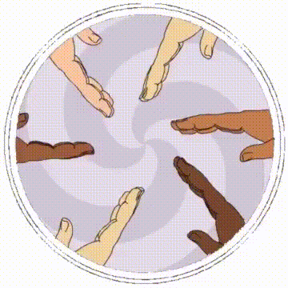

<h1 align="center">Hi , I'm Pawan</h1>
         <h4 align= "center">I am a passionate Software Engineer, Web Developer, and AI-ML-DS Enthusiast currently on a journey of continuous learning and exploration. My academic background is in Computer Science and Engineering (Artificial Intelligence & Machine Learning), and I thrive on expanding my expertise in various domains. </h4>
<!-- intro hello world -->
<h1 align="center">
  𝐇𝐄𝐋𝐋𝐎 𝐖𝐎𝐑𝐋𝐃! 

</h1>
 

- 🤖 *Machine Learning*
- 🚀 *Artificial Intelligence*
- 👨‍💻 *Ask me about Web Scraping*
- 🤝 *Looking forward to collaborate on Open source projects*
- 💬 *Feel free to reach me out for any help*
- 🖥️ *See my portfolio at*  <a href="http://pawanbhatt.pythonanywhere.com/" target="_blank">
 *My Portfolio*</a>
  
  
 

<!-- streak and trophies -->

  
  
  

 

<!-- tools and github giant logo -->

 

<h3 align = "center">𝐋𝐀𝐍𝐆𝐔𝐀𝐆𝐄𝐒 𝐀𝐍𝐃 𝐓𝐎𝐎𝐋𝐒</h3>
 
 

<code></code>
<code></code>
<code></code>
<code></code>
 
 
<code></code>&nbsp;
<code></code>
<code></code>
<code></code>
<code></code>
 

 
 
 

<!-- github stats and graph -->
<h1 align="center">
 𝐆𝐈𝐓𝐇𝐔𝐁 𝐒𝐓𝐀𝐓𝐒 
</h1>

    
<!--   most used langs table -->
    

<!-- connect section -->
<h1 align="center">
          
<h2 align="center">𝙇𝙚𝙚𝙩𝘾𝙤𝙙𝙚 𝙎𝙩𝙖𝙩𝙪𝙨 𝘾𝙖𝙧𝙙 </h2>

  <a href="https://leetcode.com/Pawan_Bhatt/" target="_blank">
    

 
 
<h2  align="center">𝐋𝐞𝐭'𝐬 𝐂𝐨𝐧𝐧𝐞𝐜𝐭 </h2>

</h1>

   
  <a href="https://www.youtube.com" target="_blank">
    <code></code>
  </a>
  <a href="https://2027285pawan@gmail.com/" target="_blank">
    <code></code>
  </a>
  <a href="https://twitter.com/" target="_blank">
    <code></code>
  </a>
  <a href="https://www.linkedin.com/in/pawan-bhatt-17821716b/?lipi=urn%3Ali%3Apage%3Ad_flagship3_feed%3BViUntV7oT8Guy3iwu1L8sQ%3D%3D">
    <code></code>
  </a>
  <a href="https://dev.to/">
    <code></code>
  </a>
  <a href="https://www.instagram.com/" target="_blank">
    <code></code>
  </a>

 

  <a href="https://www.hackerrank.com/dev/" target="_blank">
    <code></code>
  </a>

  <a href="https://www.interviewbit.com/profile/" target="_blank">
    <code></code>
  </a>

  <a href="https://www.codechef.com/users" target="_blank">
    <code></code>
  </a>
  
  <a href="https://leetcode.com/Pawan_Bhatt/" target="_blank">
    <code></code>
  </a>
  <a href="https://auth.geeksforgeeks.org/user/2027285pawan" target="_blank">
    <code></code>
  </a>
  <a href="https://stackoverflow.com/users/16775065" target="_blank">
    <code></code>
  </a>

 

<!-- outro -->

  
  
  

<h1 align="center">Hi , I'm Pawan</h1>

  

  
  
  
  

<!-- intro hello world -->
<h1 align="center">
  🤖 𝐇𝐄𝐋𝐋𝐎 𝐖𝐎𝐑𝐋𝐃! 

</h1>
 

- 🤖 *Passionate about **Artificial Intelligence** & **Machine Learning***
- 🧠 *Into **LLMs, RAG, Deep Learning, NLP** & Computer Vision*
- 🚀 *Exploring **Generative AI** — prompt engineering, fine-tuning, embeddings & vector databases*
- 👨‍💻 *Ask me about **Python, Web Scraping & DSA***
- 🤝 *Looking to collaborate on **open-source AI/ML** projects*
- 🌱 *Currently exploring: **LLM agents & multimodal AI***
- ⚡ *Solved **500+ DSA problems** (LeetCode + GeeksforGeeks)*
- 💬 *Feel free to reach out for any help!*

 

<!-- tech stack diagram -->
<h1 align="center">
 🛠️ 𝐓𝐄𝐂𝐇 𝐒𝐓𝐀𝐂𝐊 
</h1>

  

  

  

 

<h3 align="center">𝐋𝐀𝐍𝐆𝐔𝐀𝐆𝐄𝐒 𝐀𝐍𝐃 𝐓𝐎𝐎𝐋𝐒</h3>
 

<code></code>
<code></code>
<code></code>
<code></code>
<code></code>
<code></code>
 
 
<code></code>
<code></code>
<code></code>
<code></code>

 

<!-- github stats and graph -->
<h1 align="center">
 📊 𝐆𝐈𝐓𝐇𝐔𝐁 𝐒𝐓𝐀𝐓𝐒 
</h1>

    
    

 

<!-- streak and trophies -->

  
  
  

 

<!-- leetcode -->
<h2 align="center">🧩 𝙇𝙚𝙚𝙩𝘾𝙤𝙙𝙚 𝙎𝙩𝙖𝙩𝙪𝙨 𝘾𝙖𝙧𝙙</h2>

  

 

<!-- connect section -->
<h2 align="center">𝐋𝐞𝐭'𝐬 𝐂𝐨𝐧𝐧𝐞𝐜𝐭 </h2>

   
  <a href="https://linkedin.com/in/pawan-bhatt-17821716b" target="_blank">
    <code></code>
  </a>
  <a href="mailto:pawan8bhatt@gmail.com" target="_blank">
    <code></code>
  </a>
  <a href="https://github.com/Pawan-Bhatt" target="_blank">
    <code></code>
  </a>
  <a href="https://leetcode.com/u/Pawan_Bhatt/" target="_blank">
    <code></code>
  </a>
  <a href="https://auth.geeksforgeeks.org/user/2027285pawan" target="_blank">
    <code></code>
  </a>
  <a href="https://www.hackerrank.com/" target="_blank">
    <code></code>
  </a>

 
 
 

<!-- outro -->

### ⭐ 𝚂𝚑𝚘𝚠 𝚜𝚘𝚖𝚎 ❤️ 𝚋𝚢 𝚜𝚝𝚊𝚛𝚛𝚒𝚗𝚐 𝚖𝚢 𝚛𝚎𝚙𝚘𝚜𝚒𝚝𝚘𝚛𝚒𝚎𝚜!

  
### 𝚂𝚑𝚘𝚠 𝚜𝚘𝚖𝚎 ❤️ 𝚋𝚢 𝚜𝚝𝚊𝚛𝚛𝚒𝚗𝚐 the 𝚛𝚎𝚙𝚘𝚜𝚒𝚝𝚘𝚛𝚒𝚎𝚜!
